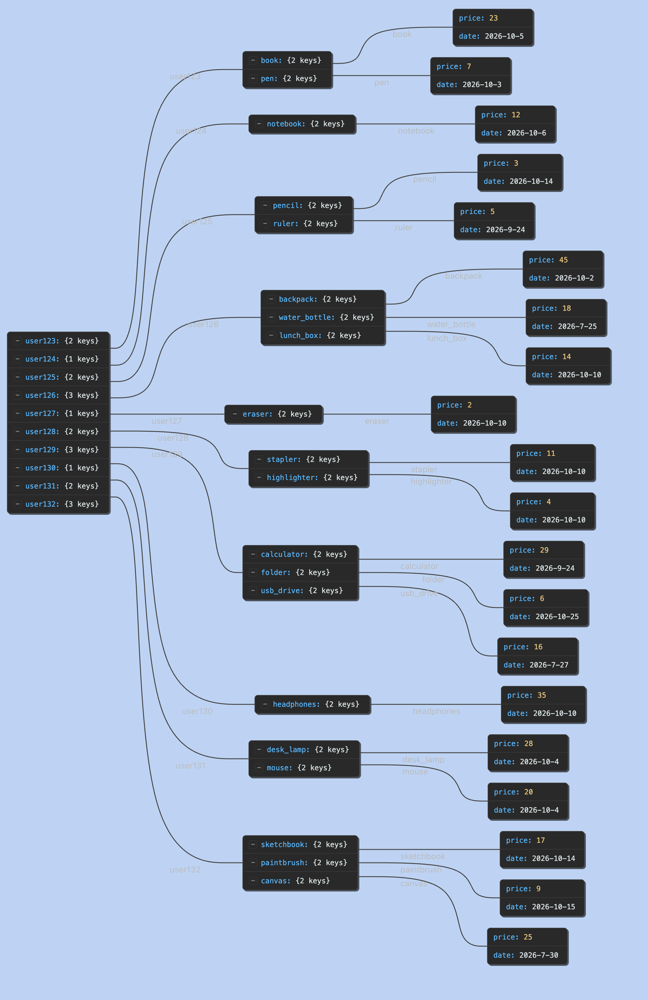

Agent_Eval
Evaluating Tool-Using AI Agents with LangChain and DeepEval

An AI-powered refund support agent built with Python, LangChain, LangGraph, OpenAI, and DeepEval, designed to evaluate not only the correctness of an agent's responses but also its tool usage, execution plan, argument selection, and task completion.

The project demonstrates an evaluation-driven approach to AI agent development, using a refund support workflow and a dataset of eight test scenarios.

Overview

A successful AI agent should do more than generate a plausible answer. It should choose the correct tools, provide appropriate arguments, follow a suitable execution plan, and complete the user's task efficiently.

Agent_Eval provides a framework for exploring these behaviors through a refund support agent and a collection of evaluation metrics.

The agent can:

Retrieve customer purchase history.
Check purchase dates and refund eligibility.
Calculate refunds for specific items or multiple items.
Generate simulated refund ticket confirmations.
Return structured responses using Pydantic.
Maintain conversation state using LangGraph checkpointing.

DeepEval is used to assess the agent's responses and execution traces against expected behavior.

Key Features
Feature	Description
AI Agent	A refund support workflow built with LangChain
Tool Calling	Purchase lookup, date retrieval, refund calculation, and simulated ticket creation
Structured Output	Pydantic models for structured agent responses
Conversation State	LangGraph checkpointing for conversation continuity
Agent Evaluation	Seven metrics covering answers, tools, planning, and task execution
Execution Tracing	Inspect agent actions and tool calls during evaluation
Test Dataset	Eight refund scenarios covering success cases and edge cases
Interactive UI	Optional Streamlit interface, if configured
Dependency Management	Reproducible Python dependencies managed using uv
Technology Stack
Technology	Role
Python 3.12+	Core programming language
LangChain	Agent orchestration and tool integration
LangGraph	Stateful agent workflows and checkpointing
OpenAI	Language model for agent execution and evaluation
DeepEval	LLM evaluation and agent execution tracing
Pydantic	Structured data and response validation
uv	Environment and dependency management
python-dotenv	Environment variable configuration
Streamlit	Optional interactive chat interface
Project Structure
text
Agent_Eval/
├── agent/
│   ├── agent.py
│   ├── data.py
│   ├── models.py
│   ├── objects.py
│   ├── prompts.py
│   ├── tools.py
│   └── streamlit_ui.py
├── evaluations/
│   ├── dataset.py
│   ├── eval_all.py
│   ├── model.py
│   ├── task_completion.py
│   ├── step_efficiency.py
│   ├── plan_quality.py
│   ├── plan_adherence.py
│   ├── argumentcorrectness.py
│   ├── answercorrectness.py
│   └── tool_correctness.py
├── understanding_metrics/
├── src/
├── DatasetJsonView.png
├── .env.example
├── .gitignore
├── pyproject.toml
├── uv.lock
└── README.md

This tree represents the expected project layout. Verify filenames against your local repository before running individual modules.

Getting Started
Prerequisites

Before installing the project, ensure you have:

Python 3.12 or later
Git
uv
An OpenAI API key with access to the configured model
1. Clone the repository
bash
git clone https://github.com/Anushbharathwaj/Agent_Eval.git
cd Agent_Eval

2. Install Python
bash
uv python install 3.12

3. Install dependencies
bash
uv sync --locked

This installs the dependencies declared in pyproject.toml and uv.lock.

4. Configure environment variables

Create a .env file in the project root. If .env.example exists, copy it as a starting point.

dotenv
OPENAI_API_KEY=your_openai_api_key_here

Replace the placeholder with your own API key.

Security: Never commit your .env file or API credentials to GitHub. Ensure .env is excluded in .gitignore.

5. Verify model configuration

Review the model configuration in:

text
agent/models.py
evaluations/model.py

Ensure the configured model identifiers are supported by your OpenAI account and installed library versions.

Running the Agent

The primary agent implementation is located at:

text
agent/agent.py

Supporting modules include:

agent/tools.py — tool definitions and refund operations.
agent/prompts.py — system instructions and refund policy.
agent/data.py — sample customer purchase records.
agent/objects.py — Pydantic response models.
agent/models.py — language model configuration.

Run the agent using the entry point provided by agent/agent.py. Check that file for the supported invocation method; the module may expose an agent object or function rather than a standalone command-line entry point.

Optional Streamlit Interface

If the Streamlit interface is configured in your repository, launch it with:

bash
uv run --env-file .env --with streamlit \
  python -m streamlit run agent/streamlit_ui.py

Open the local URL printed in the terminal.

Agent Evaluation

The main evaluation runner is expected at:

text
evaluations/eval_all.py

Run the evaluation workflow with:

bash
uv run --env-file .env python evaluations/eval_all.py

The evaluation workflow typically:

Loads the evaluation dataset.
Executes the agent against each scenario.
Captures execution traces and tool calls.
Builds test cases using actual outputs and expected behavior.
Evaluates final answers and execution behavior.
Reports metric scores, pass rates, and explanations.
Note: The command assumes evaluations/eval_all.py exists and is configured as an executable script. Confirm the entry point in your repository before running it.

LLM-based evaluations make API calls and may incur costs.

Evaluation Metrics

The project evaluates the agent across seven dimensions.

Metric	Evaluation Objective
Task Completion	Did the agent achieve the requested outcome?
Step Efficiency	Did it avoid unnecessary or redundant actions?
Plan Quality	Was the proposed execution plan appropriate?
Plan Adherence	Did execution follow the intended plan?
Argument Correctness	Were the tool arguments appropriate for the request?
Tool Correctness	Did the agent select the expected tools?
Answer Correctness	Did the final response reach the expected conclusion?

Together, these metrics help distinguish an agent that merely produces a convincing response from one that completes the task correctly and uses its tools appropriately.

Metric thresholds, scoring rubrics, and pass criteria are defined in the evaluation scripts.

Evaluation Dataset

The evaluation dataset is expected at:

text
evaluations/dataset.py

It contains eight scenarios covering different refund support behaviors.

Test Scenario	Expected Behavior
Eligible refund	Calculate the refund and create a simulated ticket
Expired refund window	Explain why the purchase is ineligible
Specific item refund	Calculate the refund for the requested item only
Multiple-item refund	Calculate the combined refund amount
Information-only request	Answer without creating a refund ticket
Missing username	Ask for the missing information
Unknown customer	Explain that the customer could not be found
Unpurchased item	Explain that the item is absent from purchase history

These scenarios test both successful workflows and cases where the agent should request clarification or decline to perform a refund action.

Dataset Visualization

If DatasetJsonView.png exists in the repository root, display it using:

markdown

Keep the evaluation dataset, sample purchase records, refund policy, and expected answers consistent to ensure meaningful evaluation results.

Understanding Evaluation Results

Evaluation reports can include scores, pass rates, and explanations for individual test cases.

When a test fails:

Review the input and expected behavior.
Inspect the final agent response.
Examine the tools selected and their arguments.
Review the execution trace.
Check the metric's evaluation criteria.
Update the agent, tools, dataset, or rubric as appropriate.
Rerun the evaluation to validate the change.

A low score does not necessarily mean the final response is incorrect. It may also indicate unnecessary tool calls, incorrect arguments, incomplete execution traces, inconsistent reference answers, or an overly strict evaluation rubric.

Average scores and pass rates should be examined separately because a reasonable average can hide individual test failures.

Limitations
Customer purchase records are sample data.
Refund ticket creation is simulated.
Refund eligibility depends on the configured policy and implementation.
Eight